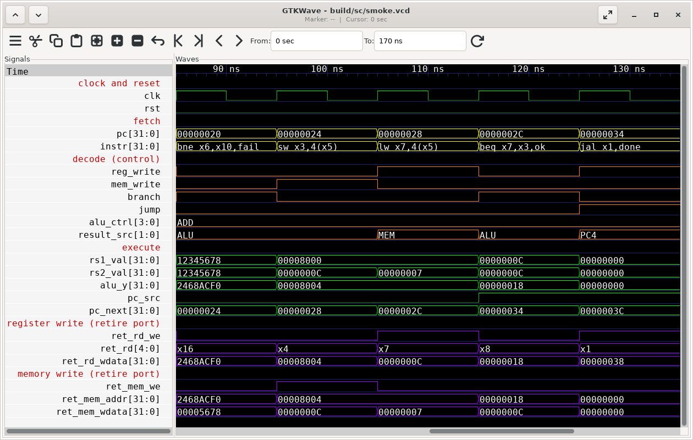
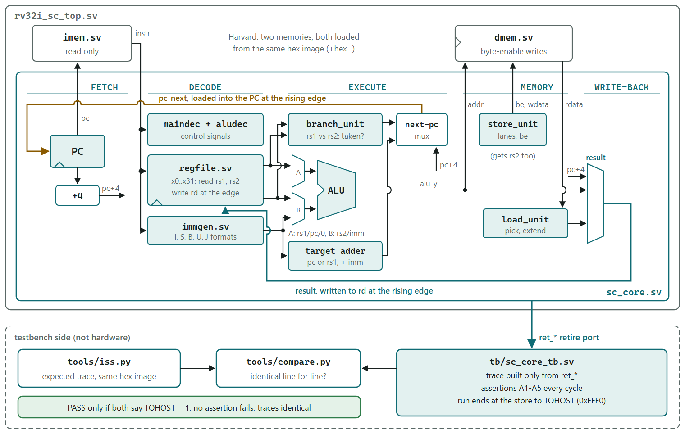
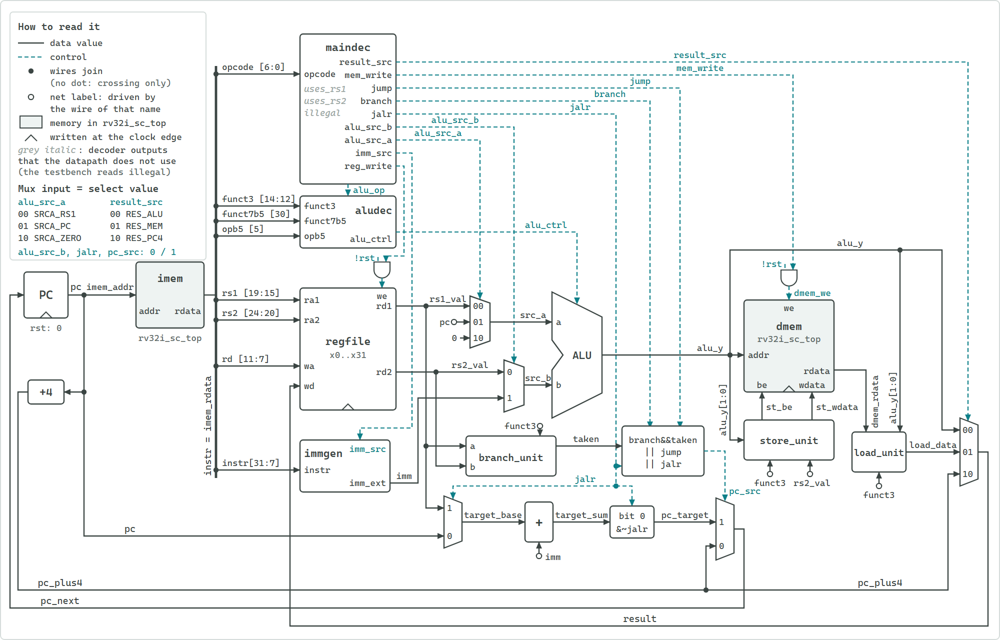
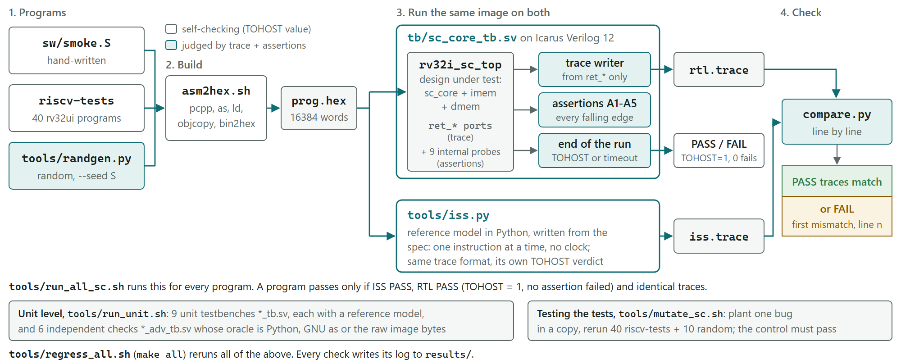

# RV32I single-cycle CPU

A single-cycle RISC-V RV32I processor in SystemVerilog, verified instruction by instruction
against a Python instruction-set simulator (ISS).

[](https://github.com/Warisback/riscv-single-cycle-cpu/actions/workflows/ci.yml)

Every instruction executes in one clock cycle. Each test program runs on the RTL in Icarus
Verilog and on the ISS, and passes only if the two traces match line for line. Planted bugs then
show that the checks can fail.

- Passes the 40 applicable rv32ui riscv-tests (the official user-level integer tests) and 220
  constrained-random programs. Every executed instruction matches the ISS trace.
- 10 of 10 planted bugs caught. One (JALR keeping bit 0 of its target) passed every official
  test and was caught only by the random programs
  ([two lessons from testing the tests](#two-lessons-from-testing-the-tests)).
- Simulation only, with Icarus Verilog 12. No synthesis yet ([limitations](#limitations)).

## The core running a program



GTKWave 3.3.126 on `build/sc/smoke.vcd`, cycles 8 to 12 (85 to 135 ns) of
[`sw/smoke.S`](sw/smoke.S). Each row is a signal and time runs left to right. Each 10 ns clock
cycle executes one instruction. The `ret_*` rows are the retire port: the core outputs that
report each instruction's register and memory writes, which is what the testbench records.

| Cycle | Instruction | What to look for |
|---|---|---|
| 8 | `bne x6,x10,fail` | Not taken: `branch` = 1, `pc_src` = 0 |
| 9 | `sw x3,4(x5)` | `ret_mem_we` = 1: writes 0000000c to 00008004 |
| 10 | `lw x7,4(x5)` | `result_src` = MEM: loads that word into x7 |
| 11 | `beq x7,x3,ok` | Taken: `pc_src` = 1, `pc_next` = 00000034 |
| 12 | `jal x1,done` | `result_src` = PC4: writes 00000038 to x1, `pc_next` = 0000003c |

[Whole run, 0 to 170 ns](docs/images/gtkwave_smoke.png), with notes in
[docs/VERIFICATION.md](docs/VERIFICATION.md#waveforms).

## Quick start

On Ubuntu or Debian:

```sh
sudo apt install git make python3 python3-pip iverilog binutils-riscv64-unknown-elf
git clone https://github.com/Warisback/riscv-single-cycle-cpu.git
cd riscv-single-cycle-cpu
make deps     # fetch riscv-tests at a pinned commit, and pcpp if Python cannot import it
make smoke    # run sw/smoke.S on the core and on the ISS
```

The output of `make smoke` should include these lines (from
[`results/sc_smoke.log`](results/sc_smoke.log)):

```
  smoke          ISS PASS RTL PASS trace same     17 instr     17 cycles
TOTAL programs=1 passed=1 instructions=17 cycles=17
PASS smoke: 1/1 programs passed
```

`make check` runs what CI runs: lint, the unit and independent-oracle checks, smoke, the
riscv-tests and 20 random programs (about 4 minutes here from a clean tree,
[`results/check.log`](results/check.log)). `make help` lists every target. On Windows, see
[Windows](#windows).

## Results

From the logs in [`results/`](results/). The last full run (`tools/regress_all.sh`, which
[`make all`](#make-targets) calls) wrote [`results/regress_all.log`](results/regress_all.log):
every step passed, and the log gives the time of each one.

| Check | Result | Log |
|---|---|---|
| Official riscv-tests, rv32ui suite (user-level integer instructions) | 40/40 pass, traces identical to the ISS | [`sc_riscv.log`](results/sc_riscv.log) |
| Constrained-random programs | 200/200 pass, 48739 instructions | [`sc_rand_n300_s1-200.log`](results/sc_rand_n300_s1-200.log) |
| Longer random programs | 20/20 pass, 29870 instructions | [`sc_rand_n2000_s1001-1020.log`](results/sc_rand_n2000_s1001-1020.log) |
| Planted bugs in the core | 10 of 10 caught; an unmodified control copy passes every program | [`sc_mutants.log`](results/sc_mutants.log) |
| Planted bugs in the register file | 2 of 2 caught; the control copy passes | [`regfile_mut.log`](results/regfile_mut.log) |
| Unit testbenches | 9/9 pass | [`unit.log`](results/unit.log) |
| Independent-oracle checks | 7/7 pass | [`adv.log`](results/adv.log) |
| Compiler warnings | `iverilog -Wall` on all 16 testbenches and the RTL: none | [`lint.log`](results/lint.log) |

Two rv32ui tests do not apply to this core and are skipped: `fence_i` and `ma_data` (see
[Limitations](#limitations)). The testbench counts cycles and retired instructions separately as
a consistency check: 90494 of each over 261 programs
([`sc_summary.log`](results/sc_summary.log)). The design has only been simulated, so there are
no area or clock-frequency figures.

## How it works

[](docs/images/architecture.svg)

`rv32i_sc_top` connects the core ([`rtl/sc_core.sv`](rtl/sc_core.sv)) to a read-only instruction
memory and a data memory, as in the block view above. The only state is the PC, the 32
registers and the data memory. Everything between two rising edges is combinational:

1. Fetch. `imem` returns the word at `pc`. `pc + 4` is computed in parallel.
2. Decode. `maindec` turns the opcode into control signals, and `aludec` picks one of ten ALU
   operations from `alu_op`, funct3, `instr[30]` and `instr[5]`. In parallel, `regfile` reads
   rs1 and rs2 and `immgen` builds the I, S, B, U or J immediate.
3. Execute. The ALU takes rs1, the PC or 0 as operand A, and rs2 or the immediate as operand B.
   In parallel, `branch_unit` compares rs1 with rs2 and a separate adder computes the target.
4. Memory. For a store, `store_unit` turns funct3 and the low address bits into byte enables
   and lane-placed data, and `dmem` writes them at the next rising edge. For a load, `dmem`
   returns the whole word and `load_unit` picks the byte or halfword and extends it.
5. Write-back. A mux picks the ALU result, the load data or `pc + 4` (for JAL and JALR), and
   `regfile` writes it to rd at the next rising edge.

The slowest instruction is a load (fetch, decode, register read, address add, memory read, load
extend, write-back mux), so that path would set the clock period. The next PC is chosen like
this:

```
pc_src    = (branch && taken) || jump || jalr
pc_target = (jalr ? rs1 : pc) + imm        bit 0 cleared for JALR
pc_next   = pc_src ? pc_target : pc + 4
```

`jump` is set for JAL only and `jalr` for JALR only. Branch and jump targets have their own
adder, so the ALU result is unused for them. Reset is synchronous and active high, and sets the
PC to 0.

[](docs/images/datapath.svg)

The datapath of `rtl/sc_core.sv`, wire for wire (the `ret_*` outputs and the misaligned flags
are left out). Solid lines carry data and dashed lines carry control. The legend gives the
select code of each mux input. Click the figure for the full-size SVG.

## Instruction set

The core decodes all 42 instructions in the RV32I listing of the ISA manual
([`decoder_adv_tb`](results/decoder_adv_tb.log): 42/42).

| Group | Instructions | Behaviour here |
|---|---|---|
| Upper immediate | LUI, AUIPC | As specified |
| Jumps | JAL, JALR | As specified. JALR clears bit 0 of the target. |
| Branches | BEQ, BNE, BLT, BGE, BLTU, BGEU | As specified |
| Loads | LB, LH, LW, LBU, LHU | Naturally aligned addresses only |
| Stores | SB, SH, SW | Naturally aligned addresses only |
| Register-immediate | ADDI, SLTI, SLTIU, XORI, ORI, ANDI, SLLI, SRLI, SRAI | As specified |
| Register-register | ADD, SUB, SLL, SLT, SLTU, XOR, SRL, SRA, OR, AND | As specified |
| Memory ordering | FENCE, FENCE.TSO, PAUSE | NOP. A core that completes every access in program order has nothing to order. |
| Environment | ECALL, EBREAK | NOP. The spec says they raise an exception, and this core has no traps. |

What is out of scope (CSRs, traps, misaligned accesses, FENCE.I) is listed under
[Limitations](#limitations).

## Verification

The checks are built in layers, and each layer takes its expected values from a different
source. Full tables, the assertion list and the run times are in
[`docs/VERIFICATION.md`](docs/VERIFICATION.md).

[](docs/images/verification_flow.svg)

| Layer | What it checks | Expected values from | Result |
|---|---|---|---|
| Unit testbenches | Each module on its own | A reference model in each testbench, written differently from the RTL | 9/9 |
| Independent-oracle checks | The same modules, and the ISS | Python models, the GNU assembler, raw image bytes | 7/7 |
| Whole programs | The core | The ISS trace, plus assertions in every cycle | 261/261 programs |
| Planted bugs | The checks themselves | An unmodified control copy must pass | 10 of 10 core, 2 of 2 register file |

### Unit and independent-oracle checks

Every module has a self-checking testbench with its own reference model, written a different way
from the RTL (the ALU model, for example, works on 64-bit integers). Those models share an author
with the RTL, so they could share a misreading of the spec. Six more testbenches therefore get
their expected values from somewhere else: Python models run outside the simulator, the GNU
assembler, and the raw bytes of the binary image. A seventh check does the same for the ISS.

### The reference model

[`tools/iss.py`](tools/iss.py) executes one instruction at a time, as the ISA manual describes
each one, with no clock. It shares nothing with the RTL except the memory image and the trace
format. Because it decides the expected answer for every program, it is checked on its own. The
40 applicable rv32ui riscv-tests pass on it alone
([`iss_riscv_tests.log`](results/iss_riscv_tests.log)), and
[`tools/iss_adv_test.py`](tools/iss_adv_test.py) runs 18737 checks against hand-computed traces,
a second Python model and GNU as ([`iss_adv.log`](results/iss_adv.log)).

### Traces and assertions

The testbench writes one trace line per executed instruction from the retire port only, and the
ISS writes the same [format](docs/DESIGN.md#trace-format). A program passes only if the ISS says
PASS, the RTL testbench says PASS, and [`tools/compare.py`](tools/compare.py) finds the two
traces identical. The RTL testbench says PASS only if the program stored 1 to TOHOST (address
0xFFF0: the program stores 1 there to report a pass) and none of its assertions fired.
[`tb/sc_core_tb.sv`](tb/sc_core_tb.sv) checks five groups of assertions (A1 to A5) at every
falling clock edge: x0 stays 0, no retire output is X or Z, the opcode is legal, stores are
well formed, and the PC follows the program. The assertions also read nine internal signals
through hierarchical references, for example the storage behind x0 for A1. The trace never uses
them. Details are in [docs/VERIFICATION.md](docs/VERIFICATION.md#when-a-program-passes).

### Test programs

- [`sw/smoke.S`](sw/smoke.S): a hand-written program (17 instructions executed), with the
  expected trace worked out in its header.
- The official rv32ui [riscv-tests](https://github.com/riscv-software-src/riscv-tests), pinned
  to commit 7b68f7b. The test sources and `test_macros.h` are used unmodified.
  [`tools/env/riscv_test.h`](tools/env/riscv_test.h) replaces the upstream environment, which
  needs CSRs and traps, with one that ends a test by a store to TOHOST. 40/40 pass on the core,
  11868 instructions.
- Constrained-random programs from [`tools/randgen.py`](tools/randgen.py): all 37
  computational, load, store and control-transfer mnemonics, mostly dependent on a recent
  result, with load-use pairs and some deliberately odd JALR targets. The programs do not check
  themselves: the trace comparison is the check. The same seed always gives the same program
  ([more detail](docs/VERIFICATION.md#program-groups-on-the-core)).

### Planted bugs

A mutant is a copy of the design with one planted bug. It is killed if any program fails.
[`tools/mutate_sc.sh`](tools/mutate_sc.sh) makes one mutant at a time and runs the 40
riscv-tests and random programs 1 to 10 on it. The real `rtl/` is never edited.

| Mutant | Bug | riscv-tests failing | Random failing | Verdict |
|---|---|---|---|---|
| `none_control` | None (control copy) | 0/40 | 0/10 | Survived, as it must |
| `jalr_bit0_kept` | JALR does not clear bit 0 of its target | 0/40 | 10/10 | Killed |
| `x0_writable` | Writes to x0 are not dropped | 21/40 | 10/10 | Killed |
| `link_is_alu` | JAL and JALR write the ALU result instead of pc + 4 | 3/40 | 10/10 | Killed |
| `auipc_zero` | AUIPC adds the immediate to 0 instead of the PC | 13/40 | 10/10 | Killed |
| `srcb_always_imm` | R-type instructions use the immediate instead of rs2 | 11/40 | 10/10 | Killed |
| `jal_not_taken` | JAL writes its link but does not jump | 4/40 | 10/10 | Killed |
| `blt_unsigned` | BLT and BGE compare unsigned | 2/40 | 8/10 | Killed |
| `sra_as_srl` | SRA shifts in zeros | 3/40 | 9/10 | Killed |
| `lb_zero_extend` | LB zero-extends | 4/40 | 10/10 | Killed |
| `store_ignores_be` | Every store writes the whole word | 2/40 | 9/10 | Killed |

What the table shows:

- The official tests caught 9 of the 10 bugs. `jalr_bit0_kept` passed all 40, and only the
  random programs caught it, because the generator makes some JALR targets odd on purpose.
- Under `jalr_bit0_kept` and `x0_writable`, no program stored a wrong value to TOHOST. Without
  the trace comparison and the assertions, both bugs would have survived
  ([`sc_mutants_detail.log`](results/sc_mutants_detail.log) shows how each mutant was caught).

[`tools/regfile_mut.sh`](tools/regfile_mut.sh) does the same for the register file against
`tb/regfile_tb.sv`: the control copy passes (120792 checks), a write-to-read bypass fails with
415 errors, and a writable x0 fails with 40009 errors.

### Two lessons from testing the tests

#### The control copy

My first version of `mutate_sc.sh` had a path bug that made every mutant look killed. The runs
were failing for a reason that had nothing to do with the planted bugs, and a perfect score was
the clue. I fixed the path and added `none_control`: an edit that changes nothing and must
survive. `mutate_sc.sh` runs it first. If the control fails any program, the script ends with
`FAIL harness`, marks every verdict above it as meaningless, and exits with an error. A checker
has to show it can say PASS on a good design as well as FAIL on a bad one.

#### The x0 write

The register file drops writes to x0 with one condition, `we && wa != 5'd0`. Removing it lets a
write land in the storage behind x0. The first version of `regfile_tb` passed this mutant: 80528
checks, 0 errors ([`regfile_mut_before.log`](results/regfile_mut_before.log)). It compared only
the read ports with its model, and the read ports return 0 for x0 whatever is stored, so from
outside a dirty x0 looks clean. `regfile_tb` now also checks the storage directly, and catches
the bug with 40009 errors. At core level the same bug left every trace identical to the ISS,
because no instruction can read the bad value. Only assertion A1, which looks at the storage,
caught it, in 31 programs (21 riscv-tests and 10 random;
[`sc_mutants_detail.log`](results/sc_mutants_detail.log)). It is a latent bug: harmless today,
but exposed by the first change that reads that storage another way, such as a bypass or a
debug port.

## Design notes

Each of these is explained in [docs/DESIGN.md](docs/DESIGN.md#design-decisions), with the module
interfaces, encodings, trace format and memory map.

- No write-to-read bypass in the register file: in a single-cycle core it would close a
  combinational loop.
- Two memories (Harvard) loaded from one image, so a fetch and a load or store happen in the
  same cycle and a program cannot modify its own code.
- Store data is zero outside the byte enables, so the trace can compare it exactly.
- ADDI is never decoded as SUB, even when bit 10 of its immediate (`instr[30]`) is 1.
- Unused controls are 0, never X, so an unknown opcode changes no state.
- A store to TOHOST ends a test, as described under [Test end and memory
  map](docs/DESIGN.md#test-end-and-memory-map).

## Running it

### Prerequisites

The [Quick start](#quick-start) lists the Ubuntu packages. `make deps` runs
[`tools/setup_deps.sh`](tools/setup_deps.sh). It fetches riscv-tests at commit 7b68f7b (only
`isa/` and `LICENSE` are kept, in `deps/riscv-tests/`), installs pcpp 1.30 (the version pinned
in `requirements.txt`) into `deps/pylib/` if Python cannot already import it, and reports whether
iverilog and the RISC-V binutils were found. The binutils are found through `RISCV_PREFIX` if it
is set, otherwise as `riscv64-unknown-elf-`, `riscv32-unknown-elf-`, `riscv64-elf-` or
`riscv64-linux-gnu-` on the PATH, and last as a local copy under `deps/rv/` (any
`bin/riscv*-as`). The logged runs used Ubuntu's `binutils-riscv64-unknown-elf` 2.45.50 package,
unpacked into `deps/rv/`.

The full regression has been run only with the versions in
[`results/tool_versions.log`](results/tool_versions.log): Icarus Verilog 12.0, binutils 2.45.50,
Python 3.14.4 and pcpp 1.30. The CI job installs the Ubuntu 24.04 packages and runs
`make check`. The setup script prints Homebrew commands for macOS, but macOS has not been
tested.

### Make targets

Each target runs one script in `tools/` and writes its log to `results/`. Times are wall-clock
for the script each target calls, from one run of `tools/regress_all.sh` (what `make all` calls)
from a clean tree, through `tools/wsl` on Ubuntu under WSL 2, with the repository on the Windows
drive
([`results/regress_all.log`](results/regress_all.log)). make itself was not installed on that
machine, so the targets were run through their scripts. Expect different times elsewhere.

| Target | What it runs | Script time here |
|---|---|---|
| `make help` | Lists the targets (the default) | |
| `make deps` | Fetches riscv-tests and pcpp, checks the tools | |
| `make check` | What CI runs (`tools/check.sh`): `lint`, `unit`, `adv`, `smoke`, `riscv-tests` and `random` in one job | 240 s |
| `make unit` | The 9 unit testbenches | 9 s |
| `make adv` | The 7 independent-oracle checks (also `make oracle`) | 45 s |
| `make smoke` | `sw/smoke.S` on the core and the ISS | 2 s |
| `make riscv-tests` | The 40 rv32ui tests on the core and the ISS. The first run also builds them and their ISS traces (100 s more). | 45 s |
| `make random` | `N` random programs (default 20) from seed `START` (default 1), `RAND_N` generated instructions each (default 300) | 491 s for 200 |
| `make long` | 20 random programs of 2000 generated instructions, seeds 1001 to 1020 | 53 s |
| `make mutants` | The 10 planted bugs and the control copy. `MUTANTS="name ..."` runs a subset. | 561 s |
| `make wave` | Smoke with a VCD dump, and a timing diagram from it (SVG; `make png` for the PNG) | 3 s |
| `make gtkwave` | The two GTKWave screenshots (needs a display) | 13 s |
| `make png` | PNG copies of the SVG figures (needs Edge, Chrome or Chromium) | |
| `make lint` | Compiler warnings: every testbench through `iverilog -Wall` | 1 s |
| `make versions` | Tool versions to `results/tool_versions.log` | |
| `make all` | The full regression (also `make regress`): unit, adv, riscv-tests on the ISS, all four program groups, both sets of planted bugs, wave and lint | 1318 s (about 22 min) |
| `make clean` | Deletes `build/`, `sw/gen/` and `sw/riscv-tests/` | |

The program groups (smoke, riscv-tests, random, long) run inside one step of the full run, so
their times are the `# elapsed` lines of their own logs. That line is timed inside the script,
after any inputs are built, so it can be shorter than the step time: for example
`sc_mutants.log` says 508 s against 561 s here. The GTKWave time is the elapsed line of
[`results/gtkwave_shot.log`](results/gtkwave_shot.log), and `make check` was timed in a separate
run from a clean tree ([`results/check.log`](results/check.log)).

To run one testbench on its own:

```sh
bash tools/run_unit.sh alu_tb +seed=7
bash tools/run_unit.sh mem_tb +hex=tb/mem_test.hex
```

### Windows

Every make target runs one script in `tools/`, and `make help` prints the script for each
target. On Windows 11, install the same Ubuntu packages inside WSL, then run a script from Git
Bash with [`tools/wsl`](tools/wsl), for example `tools/wsl run_all_sc.sh smoke`, or
`tools/wsl check.sh` for what CI runs. It starts the script in WSL with the repository root as
the working directory, and paths with spaces work. Set `WSL_DISTRO` if the distribution is not
called Ubuntu. For the PNGs, run `py tools/svg2png.py docs/images/*.svg` in Git Bash.

### Waveforms

`make wave` draws a [timing diagram](docs/images/timing_smoke.png) of the smoke program from a
VCD dump, and `bash tools/gtkwave_shot.sh --open` opens the same run in GTKWave with the grouped
signals of the screenshots. Both are described in
[docs/VERIFICATION.md](docs/VERIFICATION.md#waveforms).

## Repository layout

| Path | Contents |
|---|---|
| [`rtl/`](rtl/) | The design: `sc_core.sv` (the core), `rv32i_sc_top.sv` (core and memories), one file per unit, and `rv_pkg.sv` (shared encodings) |
| [`tb/`](tb/) | 16 testbenches: `sc_core_tb.sv` for whole programs, 9 unit and 6 independent-oracle testbenches. `mem_test.S` and `mem_test.hex` are the image that `mem_tb` loads. |
| [`tools/`](tools/) | Run scripts, the ISS, `compare.py`, `randgen.py`, the vector generators and the figure tools |
| [`tools/env/`](tools/env/) | `riscv_test.h`, the riscv-tests environment for this core |
| [`tools/gtkwave/`](tools/gtkwave/) | `smoke.gtkw` (save file) and `grab.tcl` (run by GTKWave to save each screenshot; started by `tools/gtkwave_shot.sh`) |
| [`sw/`](sw/) | `smoke.S`. Generated programs go to `sw/gen/` and `sw/riscv-tests/` (not tracked). |
| [`docs/`](docs/) | [`DESIGN.md`](docs/DESIGN.md) (interfaces, encodings, trace format, memory map), [`VERIFICATION.md`](docs/VERIFICATION.md) and the figures |
| [`results/`](results/) | Logs of the last full run ([`regress_all.log`](results/regress_all.log)), the `make check` log, the GTKWave screenshot log, and the first `regfile_tb` result |
| [`Makefile`](Makefile) | One target per check |
| [`.github/workflows/ci.yml`](.github/workflows/ci.yml) | CI on Ubuntu 24.04 (`make check`) |
| `deps/`, `build/` | Fetched and generated files (not tracked) |

In file names, `sc` means single-cycle, and `*_adv_*` marks an independent-oracle check.

## Limitations

- Simulation only, with Icarus Verilog 12.0. No synthesis has been run, so there are no area,
  timing or maximum-frequency figures. `imem` and `dmem` are behavioural models with
  combinational reads.
- RV32I only: no CSRs (Zicsr), exceptions, traps or interrupts. ECALL and EBREAK run as NOPs,
  where the spec says they trap.
- No misaligned loads or stores. A misaligned store writes nothing and a misaligned load
  returns 0. The testbench fails the run if either happens (assertion A4). This is why the
  rv32ui test `ma_data` is skipped.
- No FENCE.I (Zifencei). Instruction memory is never written, so the rv32ui test `fence_i` is
  skipped.
- Misaligned jump and branch targets are not trapped (the ISS stops the run with FAIL if one
  happens, so a test would catch it).
- Legality is decided by the opcode alone. An unknown opcode runs as a NOP and raises an
  `illegal` flag that only the testbench sees. Encodings from other extensions that share an
  RV32I opcode are not flagged: MUL runs as ADD, and CSRRW runs as a NOP.
- The random programs only branch and jump forward, so they contain no loops.
- Ten planted bugs is a small campaign. Assertions A2, A3 and A4 never fired in it, so no
  planted bug has shown that they work.
- Icarus Verilog 12 has no covergroups, so there is no functional coverage report. The
  testbenches count their own coverage (for example, checks per ALU operation in the logs).
- The 64 KiB memory repeats every 64 KiB of address space.

## Next steps

- A five-stage pipelined version, in progress at
  [Warisback/riscv-pipelined-cpu](https://github.com/Warisback/riscv-pipelined-cpu).
- Synthesis for an FPGA, to get real timing and area figures. The behavioural memories would
  have to become FPGA memories: block RAM has a registered read, so fetch and load would need
  rework (for example reading on the other clock edge), or smaller memories in
  asynchronous-read LUT RAM.
- Machine-mode traps and the Zicsr CSRs, so that ECALL, EBREAK, illegal instructions and
  misaligned accesses trap as the spec requires.

## References

- [The RISC-V Instruction Set Manual, Volume I: Unprivileged
  Architecture](https://github.com/riscv/riscv-isa-manual), version 20260120. Section and page
  numbers in the source comments refer to the PDF of this version.
- [riscv-tests](https://github.com/riscv-software-src/riscv-tests), the rv32ui tests, commit
  7b68f7b.
- [Icarus Verilog](https://github.com/steveicarus/iverilog), the simulator.
- [GTKWave](https://github.com/gtkwave/gtkwave), the waveform viewer.

## Licence

MIT, see [`LICENSE`](LICENSE). riscv-tests is fetched at setup time and keeps its own licence
(`deps/riscv-tests/LICENSE`). pcpp, installed into `deps/pylib/` by `make deps` when needed,
keeps its own licence.
