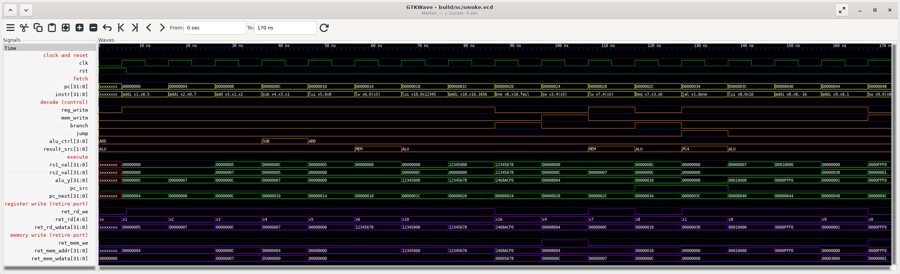
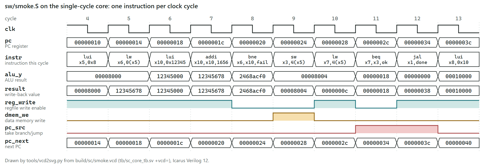

# Verification details

The detail behind the verification section of the [README](../README.md). Every count and time
below is copied from a log in [`results/`](../results/). The interfaces, the trace format and
the memory map are in [`DESIGN.md`](DESIGN.md).

## When a program passes

`tools/run_all_sc.sh` runs every program through three steps, and the program passes only if all
three say PASS:

1. `tools/iss.py` runs the image and writes the expected trace. Its own verdict comes from the
   value stored to TOHOST (address 0xFFF0: the program stores 1 there to report a pass).
2. `tb/sc_core_tb.sv` runs the same image on `rv32i_sc_top` and writes the RTL trace from the
   retire port (the `ret_*` outputs). It says PASS only if TOHOST is 1 and no assertion fired.
3. `tools/compare.py` compares the two traces line by line. On a mismatch it prints the
   matching lines before it, both versions of the first differing line and which field differs.

The traces are written in full and compared after both runs end. This is not co-simulation in
lockstep, so a failing run still goes to the end (or to the cycle limit) before the mismatch is
reported.

These are three lines of the trace of `sw/smoke.S`:

```
00000014 0002a303 x06=12345678
00000020 02a31863
00000024 0032a223 m[00008004]&f=0000000c
```

Each line is one executed instruction: the PC and the instruction word, then the register write
if there is one, then the store if there is one ([format](DESIGN.md#trace-format)).

- `lw x6,0(x5)` at 0x14 loads 0x12345678 into x6.
- `bne x6,x10,fail` at 0x20 writes nothing. Whether it was taken shows in the PC of the next
  line.
- `sw x3,4(x5)` at 0x24 stores 0x0000000c to the word at 0x8004, with all four byte enables
  set.

## Assertions in `tb/sc_core_tb.sv`

Immediate assertions, checked at every falling clock edge after reset. Any failure makes the run
FAIL, even if the program stored 1 to TOHOST.

| Assertion | Checks |
|---|---|
| A1 | x0 reads 0 on both read ports, and the storage behind x0 holds 0 |
| A2 | No `ret_*` output is X or Z |
| A3 | The executed opcode is a legal RV32I opcode |
| A4 | A store has legal byte enables, a word address and data only in its enabled lanes. No load or store is misaligned. |
| A5 | The PC follows the program: pc + 4, or the branch or jump target that the testbench computes from the instruction word and its own shadow copy of the registers |

The trace is built only from the `ret_*` outputs. The assertions also read nine internal
signals through hierarchical references: the storage behind x0 and the two read addresses and
read values (A1), the `illegal` flag (A3), and `result_src` and the two misaligned flags (A4).
The trace never uses them.

A5 fills its shadow registers from the core's own `ret_*` outputs. It therefore checks that
control flow is consistent with the values the core reported, not that those values are correct.
The trace comparison checks the values.

## Unit testbenches

`tools/run_unit_all.sh` (`make unit`), log [`results/unit.log`](../results/unit.log). Each
testbench has its own reference model, written a different way from the RTL, and prints one PASS
or FAIL line. All use seed 1 by default and take `+seed=N`.

| Testbench | Unit | Reference model and stimulus | Checks |
|---|---|---|---|
| `alu_tb` | `alu` | Model written from the spec's arithmetic on 64-bit integers, with logic results built bit by bit. Hand-worked answers, every pair of corner values, 10000 random operand pairs for each of the 16 control codes. | 162361 |
| `aludec_tb` | `aludec` | All 128 input combinations, GNU-assembled encodings and random instruction words, against a reference that decodes the whole instruction. 428 random checks had instr[30] = 1 and still expected ADD. | 162 directed, 3615 random |
| `maindec_tb` | `maindec` | All 128 opcode values against a hand-written control table and format rules, then random instruction words. | 135 directed, 2000 random |
| `branch_unit_tb` | `branch_unit` | Subtraction-based model, a hand-worked table, every pair of corner values for all 8 funct3 values, random operands. | 21664 |
| `immgen_tb` | `immgen` | GNU-assembled golden encodings, corner cases, walking ones and zeros, random encode and decode round trips. | 26528 |
| `load_unit_tb` | `load_unit` | Every funct3 and byte offset against a byte-level model, plus store-then-load round trips through `store_unit`. | 84328 |
| `store_unit_tb` | `store_unit` | Byte enables, lane placement and the misaligned flag for every funct3 and byte offset; unused lanes must be zero. | 64624 |
| `regfile_tb` | `regfile` | Array model with directed and random traffic: writes to x0, read and write of the same register in one cycle, reset in mid-run. A white-box check that the storage behind x0 stays 0. | 120792 |
| `mem_tb` | `imem`, `dmem` | Byte-addressed reference memory: image loading, every SB, SH and SW byte-enable pattern, 64 KiB aliasing, read after write, and that stores never reach `imem`. | 213 directed, 7699 random |

## Independent-oracle checks

`tools/run_adv_all.sh` (`make adv`, or `make oracle`), log [`results/adv.log`](../results/adv.log).
The unit models above share an author with the RTL, so they could share a misreading of the
spec. These checks take their expected values from somewhere else. Their files are named
`*_adv_*`.

| Check | Unit | Where the expected values come from | Checks |
|---|---|---|---|
| `immgen_adv_tb` | `immgen` | Immediates chosen before assembly and encoded by GNU as. The result must not change when the other instruction fields are randomised. | 91535 |
| `alu_adv_tb` | `alu` | 54672 vectors from a Python generator (at least 3411 per control code), replayed in file order and again in random order. | 109344 |
| `branch_unit_adv_tb` | `branch_unit` | Python vectors in file order, then 50000 random-order replays. Every branch type is seen both taken and not taken. | 249016 |
| `decoder_adv_tb` | `maindec`, `aludec` and a one-instruction execute slice | 972 words from GNU as: 950 RV32I words covering all 42 rows of the RV32I listing (42/42), and 22 words from other extensions. The expected result uses the immediate as written in the assembly source. | 33272 |
| `loadstore_adv_tb` | `store_unit` with `load_unit` | 26434 Python vectors covering every funct3 and byte offset for the store, against every funct3 and byte offset for the load, cross-checked against a second model in the testbench, then 20000 random steps on one memory word. | 139302 |
| `mem_adv` | `imem`, `dmem` | Bytes read straight from the raw binary image. All 16 byte-enable patterns, write-enable glitches and a sweep of all 64 KiB, over 8 image cases (one log each in [`results/mem_adv/`](../results/mem_adv/)). | 8/8 cases |
| `iss_adv_test` | `tools/iss.py` | Hand-computed expected traces, a second Python model and GNU as (see below). | 18737 |

`decoder_adv_tb` prints a NOTE for each word from another extension that shares an RV32I opcode,
for example `mul` (it runs as ADD) and `csrrw` (it runs as a NOP). This is the "legality by
opcode only" limitation, shown on purpose.

## Checking the reference model

`tools/iss.py` decides the expected trace for every program, so a bug in it would hide the same
bug in the RTL. It is checked two ways.

- The 40 applicable rv32ui riscv-tests pass on the ISS alone (`tools/run_riscv_tests_iss.sh`,
  [`results/iss_riscv_tests.log`](../results/iss_riscv_tests.log)). `fence_i` and `ma_data` are
  skipped, with the reason in the log.
- `tools/iss_adv_test.py` ([`results/iss_adv.log`](../results/iss_adv.log)): 18737 checks.
  Directed cases with hand-computed traces target what the official tests barely touch (shift
  amounts with bit 5 set, SLTIU with a sign-extended immediate, JALR with rd equal to rs1, every
  store width at every legal offset). Random single instructions are checked against a second
  model that never decodes instruction bits. Every encoding it builds is also assembled by GNU
  as, and the words must agree (3182 encodings). Each check also compares all 32 registers and
  all 64 KiB of data memory, so a side effect anywhere else is caught.

## Program groups on the core

From [`results/sc_summary.log`](../results/sc_summary.log). Each log has one row per program.

| Group | Command | Programs | Instructions | Cycles | Log |
|---|---|---|---|---|---|
| Smoke | `make smoke` | 1 | 17 | 17 | [`sc_smoke.log`](../results/sc_smoke.log) |
| rv32ui riscv-tests | `make riscv-tests` | 40 | 11868 | 11868 | [`sc_riscv.log`](../results/sc_riscv.log) |
| Random, seeds 1 to 200, `--n 300` | `make random N=200` | 200 | 48739 | 48739 | [`sc_rand_n300_s1-200.log`](../results/sc_rand_n300_s1-200.log) |
| Random, seeds 1001 to 1020, `--n 2000` | `make long` | 20 | 29870 | 29870 | [`sc_rand_n2000_s1001-1020.log`](../results/sc_rand_n2000_s1001-1020.log) |
| All four groups | | 261 | 90494 | 90494 | [`sc_summary.log`](../results/sc_summary.log) |

`--n` is the number of instructions the generator writes. Fewer execute, because a taken branch
or a jump skips code. The testbench counts instructions and clock cycles separately, so equal
totals are a consistency check of a single-cycle core, not a performance result.

The random programs come from `tools/randgen.py`. They use all 37 computational, load, store and
control-transfer mnemonics, a small register pool with sources biased towards the last few
results (so most instructions depend on a recent one), load-use pairs, aligned loads and stores
across a 4 KiB data area, and some deliberately odd JALR targets. Branches and jumps only go
forward, so every program ends.

## Planted bugs

### Core (`tools/mutate_sc.sh`, [`results/sc_mutants.log`](../results/sc_mutants.log))

A mutant is a copy of the design with one planted bug: one exact text replacement in a copy of
`rtl/`, `tb/` and `tools/` under `build/mut/<name>/`. Each runs the 40 riscv-tests and random
programs 1 to 10. A mutant is killed if any program fails. `make mutants MUTANTS="x0_writable
sra_as_srl"` runs a subset (log: `results/sc_mutants_part.log`; the control always runs first),
and `bash tools/mutate_sc.sh --list` lists the names.

How each mutant was caught, from
[`results/sc_mutants_detail.log`](../results/sc_mutants_detail.log) (made by
`tools/mutant_report.py` from the outputs in `build/mut/`):

- For every mutant except `x0_writable`, every failing program also had a trace that differed
  from the ISS.
- Under `jalr_bit0_kept` and `x0_writable`, no program stored a wrong value to TOHOST. With
  self-checking programs alone, both bugs would have survived.
- Under `auipc_zero`, 10 programs never reached their TOHOST store, and only the cycle limit
  (`+maxcycles`, default 200000) ended them.
- A5 fired under the three control-flow bugs (`jalr_bit0_kept`, `jal_not_taken`,
  `blt_unsigned`). A1 fired under `x0_writable`, in all 31 failing programs, and nothing else
  caught that one.
- A2, A3 and A4 never fired. No planted bug has shown that they work.

### Register file (`tools/regfile_mut.sh`, [`results/regfile_mut.log`](../results/regfile_mut.log))

| Copy | Change | `regfile_tb` result |
|---|---|---|
| control | none | PASS, 120792 checks, 0 errors |
| bypass | read port 1 returns the value being written when it reads the register being written | FAIL, 415 errors |
| x0_writable | writes to x0 are not dropped | FAIL, 40009 errors |

The first version of `regfile_tb` compared only the read ports with its model, and passed
`x0_writable` with 80528 checks and 0 errors
([`results/regfile_mut_before.log`](../results/regfile_mut_before.log)).

## Waveforms



GTKWave 3.3.126 on `build/sc/smoke.vcd`, the whole run of `sw/smoke.S` from 0 to 170 ns
(`make gtkwave`, [`results/gtkwave_shot.log`](../results/gtkwave_shot.log)). Each 10 ns clock
cycle executes one instruction: 17 instructions in 17 cycles.

- Reset is high over the first rising edge, at 5 ns. Before that edge, `pc` and `instr` are X.
- Cycle 0 (5 to 15 ns) runs `addi x1,x0,5` at PC 0. Each cycle after it runs the next
  instruction, or the branch or jump target.
- The run ends at 170 ns, halfway through cycle 16, when the testbench sees `sw x9,0(x8)` store
  1 to TOHOST. That is why the last label is cut short.
- Signals are grouped from top to bottom: clock and reset, fetch, decode (control), execute,
  then the register write and the memory write as the retire port reports them. `instr` is shown
  as assembly, and `alu_ctrl`, `result_src` and `ret_rd` by name.
- `rs1_val` and `rs2_val` are the register-file read values, not the ALU operands. In cycle 0,
  `rs2_val` is 00000000 while ALU operand B is the immediate 5.
- `ret_rd`, `ret_mem_addr` and `ret_mem_wdata` show the raw port values in every cycle. They
  only mean something while `ret_rd_we` or `ret_mem_we` is 1.

`make wave` runs the same program with a VCD dump and draws this timing diagram from it with
`tools/vcd2svg.py`. Every value in it is also listed in
[`results/sc_wave.log`](../results/sc_wave.log).

[](images/timing_smoke.svg)

Cycles 4 to 13, from `lui x5,0x8` at PC 00000010 to `lui x8,0x10` at PC 0000003c.

To open the same run in GTKWave with the grouped signals of the screenshots (needs
`sudo apt install gtkwave` and a display; on Windows 11, WSLg provides one):

```sh
bash tools/gtkwave_shot.sh --open        # Git Bash: tools/wsl gtkwave_shot.sh --open
```

This builds the VCD if needed, writes the alias files that show `instr` as assembly, and opens
`build/sc/smoke.vcd` with the save file `tools/gtkwave/smoke.gtkw`. GTKWave writes absolute
paths when it saves a session, so save any changes to a new file.

## Run times

Wall-clock seconds from one run of `tools/regress_all.sh` (`make all`) from a clean tree, started
through `tools/wsl` on Ubuntu under WSL 2 on Windows 11, with the repository on the Windows drive.
[`results/regress_all.log`](../results/regress_all.log) gives the time of each step. The program
groups run inside one step, so their times are the `# elapsed` lines of their own logs. Expect
different times on other machines.

| Step | Seconds | Script |
|---|---|---|
| Unit testbenches | 9 | `tools/run_unit_all.sh` |
| Independent-oracle checks | 45 | `tools/run_adv_all.sh` |
| riscv-tests on the ISS (also builds them) | 100 | `tools/run_riscv_tests_iss.sh` |
| All four program groups on the core | 594 | `tools/run_all_sc.sh all` |
| of which smoke | 2 | (`results/sc_smoke.log`) |
| of which riscv-tests | 45 | (`results/sc_riscv.log`) |
| of which 200 random programs, `--n 300` | 491 | (`results/sc_rand_n300_s1-200.log`) |
| of which 20 random programs, `--n 2000` | 53 | (`results/sc_rand_n2000_s1001-1020.log`) |
| Planted bugs, core | 561 | `tools/mutate_sc.sh` |
| Planted bugs, register file | 5 | `tools/regfile_mut.sh` |
| Waveform figure | 3 | `tools/make_wave_fig.sh` |
| Lint | 1 | `tools/lint_sc.sh` |
| Total | 1318 | `tools/regress_all.sh`, about 22 minutes |

The `# elapsed` line at the end of each log is timed inside the script, after any inputs are
built, so it can be shorter than the step time above. For example, `results/sc_mutants.log`
says 508 s against 561 s here, because `tools/mutate_sc.sh` builds the test programs before its
timer starts. The GTKWave screenshots are not part of the full run:
`results/gtkwave_shot.log` gives 13 s.

`make check` (what CI runs, `tools/check.sh`) took 240 s from a clean tree, in a separate
run before the full one ([`results/check.log`](../results/check.log) gives the time of each
step).

## Tool versions

From [`results/tool_versions.log`](../results/tool_versions.log) (`make versions`):

| Tool | Version |
|---|---|
| OS | Ubuntu 26.04.1 LTS under WSL 2 |
| Icarus Verilog (iverilog, vvp) | 12.0 (stable) |
| GNU binutils for RISC-V (as, ld, objcopy, objdump) | 2.45.50.20251209 |
| Python | 3.14.4 |
| pcpp | 1.30 |
| riscv-tests | commit 7b68f7b91f827f8d94cc1c57ff123752c5c8f704 |
| GTKWave (viewing only) | 3.3.126 |

The binutils are Ubuntu's `binutils-riscv64-unknown-elf` package, unpacked into `deps/rv/`
(the last place `tools/common.sh` looks). The full regression has been run with these versions
only.
